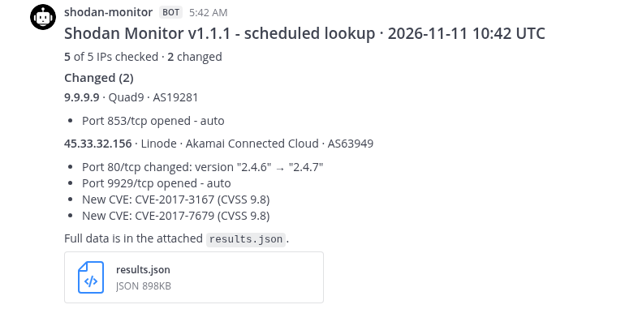
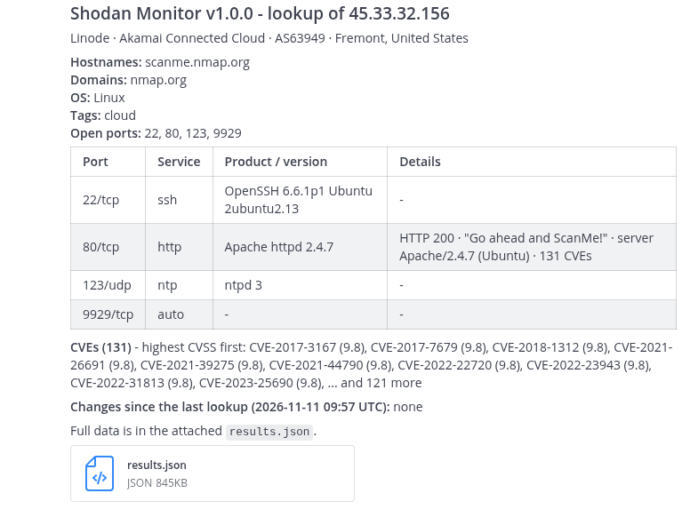
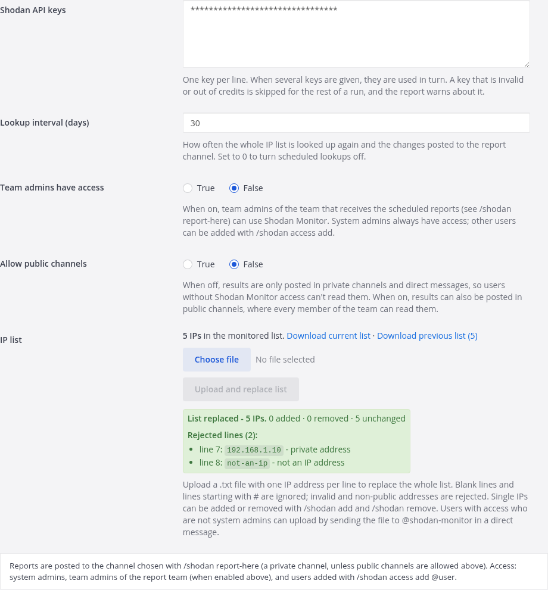

# Shodan Monitor for Mattermost

[](https://github.com/teodoramz/mattermost-plugin-shodan-monitor/actions/workflows/ci.yml)
[](https://github.com/teodoramz/mattermost-plugin-shodan-monitor/releases)
[](./LICENSE)

Monitors a list of public IP addresses with [Shodan](https://www.shodan.io) and posts what changed
(open ports, software versions, CVEs, hostnames) to a Mattermost channel, with the full data attached
as `results.json`.



## Features

- **IP list**: upload a `.txt` file (one IP per line), add or remove single IPs. Only public IPs are
  accepted; rejected lines are listed with the reason.
- **Scheduled lookups**: every N days (default 30) the list is looked up again and only the IPs that
  changed are reported.
- **On-demand lookups**: one IP or the whole list, using Shodan's stored data (no credits used).
- **Active scans**: ask Shodan to scan one IP or the whole list now (1 scan credit per IP).
- **Multiple API keys**: used in turn; keys Shodan rejects are skipped and reported.
- **Access control**: system admins, optionally team admins, and users added by a system admin.

| Single IP lookup | Settings |
|---|---|
|  |  |

## Usage

| Command | Description |
|---|---|
| `/shodan status` | List size, schedule, report channel, API key credits |
| `/shodan list` | Show the IP list |
| `/shodan add <ip>` / `remove <ip>` | Add or remove one IP |
| `/shodan lookup <ip>` / `lookup all` | Look up now (no credits) |
| `/shodan scan <ip>` / `scan all [confirm]` | Active scan (uses scan credits) |
| `/shodan report-here` | Post scheduled reports in this channel (system admins) |
| `/shodan access add\|remove\|list @user` | Manage access (system admins) |

To replace the whole list, use **Upload** in the plugin settings, or send the `.txt` file to
@shodan-monitor in a direct message.

## Configuration

System Console > Plugins > Shodan Monitor:

| Setting | Default | |
|---|---|---|
| Shodan API keys | | One per line |
| Lookup interval (days) | 30 | `0` disables scheduled lookups |
| Team admins have access | Off | Team admins of the team that receives the reports |
| Allow public channels | Off | Also post results in public channels |
| IP list | | Upload / download the list |

Then run `/shodan report-here` in the channel that should get the reports. It must be private unless
**Allow public channels** is on.

## Security

- By default, results are posted only in private channels and direct messages, so users without access
  can't read them. **Allow public channels** changes this.
- The HTTP API is limited to system admins and protected against CSRF by Mattermost.
- Text coming from Shodan is escaped: it cannot add links, formatting or `@mentions` to posts.
- API keys are never posted, logged or written to `results.json`.

## What counts as a change

Open/closed ports; service, product, version and OS per port; HTTP status, server and title; TLS
certificate; added/removed CVEs; hostnames, domains, tags; organization, ISP, ASN, location.
Timestamps and raw banners are ignored.

## Install

Download the bundle from [Releases](https://github.com/teodoramz/mattermost-plugin-shodan-monitor/releases)
and upload it in System Console > Plugins > Plugin Management.

## Development

Requires Go and Node.js.

```bash
make dist            # build the bundle into dist/
make test            # tests
make check-style     # lint
docker compose up -d # local Mattermost on http://localhost:8065
```

Setting `SHODAN_MONITOR_API_URL` on the Mattermost server points the plugin at another Shodan API URL
(for testing against a mock).

## Releasing

The version is the `version` field in `plugin.json`.

```bash
make patch   # or: make minor / make major
```

Add a section for the new version to `CHANGELOG.md`, then commit and push to `main`. The release
workflow tags `vX.Y.Z` and publishes the release with the plugin bundles.

## Disclaimer

Not affiliated with or endorsed by Shodan. Only monitor and scan IP addresses you own or are
authorized to assess, and follow the [Shodan Terms of Service](https://account.shodan.io/legal).

## License

[Apache License 2.0](./LICENSE)
